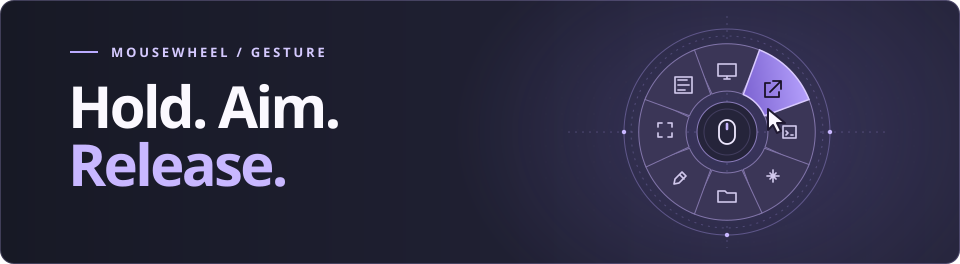

# 紫小因 · Zain

我做东西时，愿意在手感和氛围上多花点时间。一个动作顺不顺，声音该早一点还是晚一点，常常是亲手试过才有数。有时候来回试了几遍，最后还是删掉了刚加的东西。

**编程语言**　  \
**开发工具**　  

## 代表项目

### [MouseWheel](https://github.com/zainSama233/MouseWheel) · 单手鼠标快捷轮盘

按住中键，移到目标后松开。启动应用和网页、截图贴图、屏幕标注和 OCR，都能从鼠标旁开始，少切几次窗口。

用 **C++20 / Qt 6** 和原生系统接口实现。Windows 10 已实测，提供免安装单 EXE；Windows 11 待专项验收，macOS 为实验性适配。

**[下载 v0.7.0 预览版](https://github.com/zainSama233/MouseWheel/releases/tag/v0.7.0)** · [查看验证记录](https://github.com/zainSama233/MouseWheel/blob/main/docs/validation.md)

## 独立 RPG

一款用 Godot 开发的像素风横版动作 RPG。故事随玩家探索彼此相连的区域逐步展开。角色的成长不只意味着变强，也关乎一路上坚持什么、放下什么。
